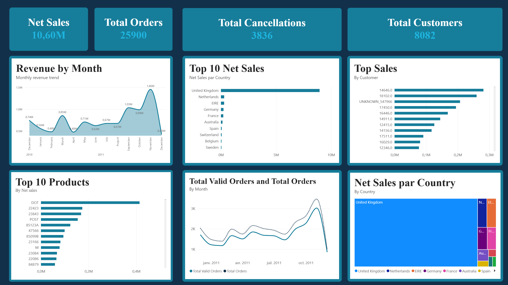

# Online Retail Data Analysis

## Project Overview

An end-to-end data analytics project using the Online Retail dataset. The objective is to transform raw transactional data into a structured data warehouse and build an interactive Power BI dashboard to analyse sales performance, customer behaviour, products and order cancellations.

## Dashboard Preview



## Project Workflow

The project follows three main stages:

### 1. ETL — Python & Pandas
- Explored the raw dataset and assessed data quality.
- Identified and handled missing values and duplicate records.
- Investigated zero unit prices and estimated prices where possible.
- Created transaction indicators for cancellations and negative transactions.
- Generated a cleaned dataset ready for analysis.

**Main file:** `src/clean_data.py`

### 2. Database — PostgreSQL
- Created a staging layer to load the cleaned dataset.
- Designed a dimensional data warehouse using a star schema.
- Created fact and dimension tables.
- Implemented primary keys, foreign keys and relationships.
- Validated data consistency between staging and warehouse layers.

**Schemas:** `staging` and `warehouse`

### 3. Data Visualization — Power BI
- Connected Power BI to the PostgreSQL data warehouse.
- Built a dimensional data model.
- Created DAX measures and KPIs.
- Designed an interactive dashboard to explore business performance.

**Dashboard file:** `powerbi/warhouse_online_retail.pbix`

## Key Business Metrics

The dashboard includes:
- Net Sales
- Total Orders
- Total Customers
- Cancellation Rate
- Revenue trends over time
- Top 10 products by net sales
- Top 10 countries by net sales
- Monthly order volume
- Returned quantities
- Top customers by net sales
- Sales distribution by country

## Technologies

- **Python:** Pandas, NumPy
- **Database:** PostgreSQL
- **Visualization:** Microsoft Power BI, DAX
- **Development:** Jupyter Notebook, VS Code, Git

## Dataset

The project uses the [UCI Online Retail dataset](https://archive.ics.uci.edu/dataset/352/online+retail), containing transactions from a UK-based online retailer between December 2010 and December 2011.

The original dataset contains 541,909 transactions.

## Repository Structure

```text
online-retail-data-analysis/
├── data/
│   ├── raw/
│   └── processed/
├── notebooks/
│   └── 01_exploration.ipynb
├── src/
│   └── clean_data.py
├── sql/
├── powerbi/
│   ├── warhouse_online_retail.pbix
│   └── dashboard_overview.png
├── docs/
├── .gitignore
└── README.md
```

## How to Explore the Project

1. Review the exploratory analysis in `notebooks/`.
2. Explore the Python transformation pipeline in `src/`.
3. Review the SQL scripts in `sql/`.
4. View the dashboard preview above or open the Power BI file.

**Note:** The raw and processed datasets are excluded from this repository. Download the original dataset from UCI to reproduce the workflow.